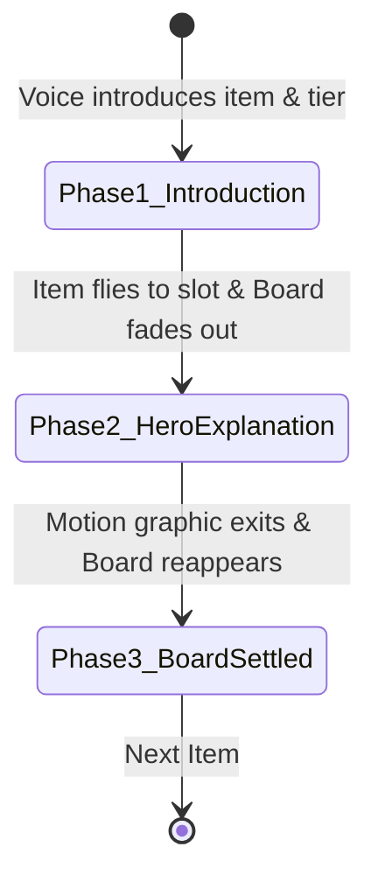

# Tier List / Ranking Video Production System

This skill defines the complete architectural standard, layout geometry, animation choreography, and production runbook for high-retention **Tier List / Ranking short-form videos** in Remotion. It is universally applicable to any ranking topic (software tools, productivity apps, marketing channels, business models, hardware, skills, or books).

## Production and motion routing

Use this layout only when the content is actually a ranking. Follow
[ai-video-pipeline](../ai-video-pipeline/SKILL.md) for raw voice, canonical timing, file permissions and render approval.
Use [physical-interaction-direction](../physical-interaction-direction/SKILL.md) when items move into rows,
displace another card, snap, stack or react to a shared event. Preserve the selected project's tokens and identity;
for the user's paper continuation use [paper-motion-continuity.md](../motion-graphic-design/references/paper-motion-continuity.md).
Row placement must preserve the spoken ranking; animation must not imply an unsupported score/order.

---

## 1. Core Architecture & Vertical Stage Zones (1080x1920)

Ranking videos feature a persistent talking head paired with an evolving tier list board and contextual motion graphics. To avoid UI crowding and satisfy mobile platform safe areas (TikTok, Reels, Shorts), the layout is strictly compartmentalized into 4 vertical zones:

```text
 0px ┌──────────────────────────────────────────────┐
     │ Zone 1: Persistent Title Header              │ y: 140 - 240px
     ├──────────────────────────────────────────────┤
     │ Zone 2: Upper Stage (Dynamic Content)        │ y: 320 - 940px
     │   - State A: Interactive Tier Board (S/A/B/C/F)
     │   - State B: Hero Motion Graphic (Bespoke Metaphor)
     ├──────────────────────────────────────────────┤
     │ Zone 3: Speech-Synced Dynamic Caption        │ y: 940 - 1180px
     │   - Vertically centered between board & face │
     ├──────────────────────────────────────────────┤
     │ Zone 4: Speaker Card (Talking Head)          │ y: 1180 - 1680px
     │   - Floating rounded card, zoom-out webcam   │
1920px└─────────────────────────────────────────────┘ Margin bottom: 240px
```

### Screen Padding Rule (The 100px Rule)
- **Lateral Margins**: Always maintain a minimum of **100px padding** on both the left and right edges (`left: 100`, `width: 880` in a 1080px canvas).
- **Bottom Margin**: The speaker card must terminate at or above $y = 1680\text{px}$, leaving **240px safe area** at the bottom for TikTok/Reels usernames, captions, and engagement icons.
- **Top Margin**: Title begins at $y = 140\text{px}$, safely below native platform headers.

---

## 2. Geometry & Shared Constants

All coordinates and dimensions are centralized in `src/visual-systems/ranking/constants.ts`:

```typescript
export const CANVAS_WIDTH = 1080;
export const CANVAS_HEIGHT = 1920;
export const FPS = 30;

// Color Palette
export const BRAND_COLORS = {
  background: '#F9F8F6',     // Premium warm cream background
  textDark: '#0F172A',       // Deep slate navy for main headings
  textBody: '#1A1816',       // Off-black for caption words
  accentOrange: '#DE7356',   // Terracotta orange for badges and speech highlight
  borderWhite: '#FFFFFF',
  slotBg: '#CBD5E1',         // Muted slate gray for empty tier rows
};

// Standard Tier Configs (S -> F)
export const TIER_CONFIGS = [
  { id: 'S', label: 'S', color: '#EF4444', bg: '#FEE2E2' },
  { id: 'A', label: 'A', color: '#FF9F43', bg: '#FFF7ED' },
  { id: 'B', label: 'B', color: '#FECA57', bg: '#FEFCE8' },
  { id: 'C', label: 'C', color: '#F1C40F', bg: '#FEF9C3' },
  { id: 'F', label: 'F', color: '#54A0FF', bg: '#EFF6FF' },
];

// Tier Board Geometry
export const BOARD_LAYOUT = {
  left: 100,
  width: 880,
  top: 320,
  rowHeight: 114,
  rowGap: 12,
  badgeWidth: 96,
  badgeHeight: 96,
  slotStartX: 100 + 10 + 96 + 18, // 224px
  slotSize: 90,
};

// Speaker Face Card Geometry
export const SPEAKER_LAYOUT = {
  left: 160,
  top: 1180,
  width: 760,
  height: 500,
  borderRadius: 32,
};
```

---

## 3. Dynamic 3-Phase Upper Stage Lifecycle

Each ranked item cycles through 3 seamless visual phases in Zone 2:



1. **Phase 1: Item Introduction & Fly-In**
   - The **Tier Board** is visible.
   - The item's card spawns at screen center via `FloatingRankCard` with an overshoot spring pop.
   - The card breathes while the speaker speaks the name and tier.
   - At `fly_frame`, the card smoothly glides into its target tier row slot $(x_{target}, y_{target})$, scaling down to fit the row slot.
2. **Phase 2: Hero Motion Graphic (In-Depth Explanation)**
   - The Tier Board fades out smoothly (`opacity: 0`, `translateY: -20px`).
   - The scene's **Hero Motion Graphic** (selected from `motion-graphic-design` primitives) fades and springs into Zone 2.
   - Explains the core insight/tension with 1-second visual clarity (e.g. Sinking Feed, Gated Paywall, Typing Cursor, Connected Pipeline, etc.).
3. **Phase 3: Board Reappearance & Settled State**
   - The motion graphic exits cleanly with an 8-frame fade-out.
   - The Tier Board fades back in, permanently displaying the newly locked item in its row alongside previously placed items.

---

## 4. Subtitle & Speaker Framing Rules

### A. Mathematical Subtitle Centering (`CaptionText.tsx`)
Subtitles float directly in the mathematical dead center between Zone 2 and Zone 4:
```typescript
const rankBoardBottom = BOARD_LAYOUT.top + 5 * BOARD_LAYOUT.rowHeight + 4 * BOARD_LAYOUT.rowGap; // ~938px
const speakerCardTop = SPEAKER_LAYOUT.top; // 1180px

// Container height: 242px, vertically centered
<div style={{
  position: 'absolute',
  top: rankBoardBottom,
  height: speakerCardTop - rankBoardBottom,
  left: 0,
  width: 1080,
  display: 'flex',
  alignItems: 'center',
  justifyContent: 'center',
}}>
```
- **Word Chunking**: Short phrases of 2 to 4 words.
- **Active Spoken Word**: Accent color highlight (`#DE7356`), `transform: 'scale(1.08)'`, no shadow.
- **Word Gap**: Maintain `gap: 24 - 28px` between word tokens so enlarged active words never collide.

### B. Natural Talking Head Card (`TalkingHead.tsx`)
- Display the speaker inside a clean, rounded floating card (`borderRadius: 32`).
- Scale raw webcam footage moderately (`scale: 0.68 - 0.72`) with offset `targetY: 920` to comfortably display head, neck, and shoulders without claustrophobic facial close-ups.
- High-elevation soft shadow: `boxShadow: '0 28px 65px rgba(15, 23, 42, 0.16), 0 6px 18px rgba(15, 23, 42, 0.08)'`.

---

## 5. Architectural Separation: Engine vs. Episode Layer

To scale across dozens of episodes without duplicating layout code, enforce strict 2-tier modularity:

```text
src/
├── visual-systems/
│   └── ranking/                          # [REUSABLE ENGINE]
│       ├── components/
│       │   ├── TierBoard.tsx             # S/A/B/C/F grid & item slots
│       │   ├── FloatingRankCard.tsx      # Flying item animation
│       │   ├── TalkingHead.tsx           # Webcam frame & shadow
│       │   ├── TitleHeader.tsx           # Persistent category headline
│       │   └── CaptionText.tsx           # Centered synchronized subtitles
│       ├── constants.ts                  # Canvas geometry & colors
│       ├── types.ts                      # Interfaces for scenes, tiers, cards
│       └── index.ts                      # Clean barrel export
│
└── videos/
    └── ranking/
        └── <episode-slug>/               # [UNIQUE EPISODE CONTENT]
            ├── scenes/                   # Episode-specific motion graphics
            │   ├── Scene1_Hero.tsx       # e.g. SinkingFeedScene
            │   ├── Scene2_Hero.tsx       # e.g. TypingCursorScene
            │   ├── Scene3_Hero.tsx       # e.g. PaywallLockScene
            │   └── OutroScene.tsx        # e.g. InteractivePollScene
            ├── RankingVideo.tsx          # Composition assembling engine + scenes
            ├── index.ts
            └── (mirrored in videos/ranking/<episode-slug>/ for data/output)
```

---

## 6. QA Review & Verification Protocol

Before render approval, perform static timeline/geometry/contact/audio checks and leave pixel/playback QA pending.
Only after an explicitly approved project/version has been rendered, extract the multi-scene review grid from
that output and inspect `output/review.png` once. Do not invoke a renderer from this QA step or rerender to verify:
1. **Key Visual Checkpoints**:
   - Frame A: Title Header visibility and opening hook item spawn.
   - Frame B: Mid-flight card interpolation entering the tier row.
   - Frame C: Active Hero Motion Graphic in Zone 2 during explanation.
   - Frame D: Active spoken word highlight in Zone 3 (no overlap with face card).
   - Frame E: Outro summary showing completed tier board and call-to-action.
2. **Quality Checklist**:
   - [ ] Are cards/containers or open compositions chosen by meaning, with one clear action and enough reading hold?
   - [ ] Are placement/contact/state changes synchronized to the spoken claim and readable at the actual display size?
   - [ ] Is there $\ge 100\text{px}$ horizontal padding and $\ge 240\text{px}$ bottom safe zone?
   - [ ] Are all icons sourced as crisp Font Awesome vectors?
