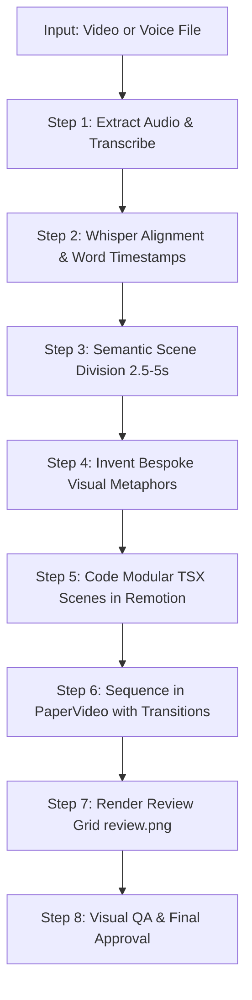

# Paper Minimal Editorial & Motion Graphics Master System

This skill is the **primary and official video editing standard** for producing world-class, programmatic, short-form motion graphic videos (1080x1920 vertical, 30fps) using Remotion and TypeScript.

It synthesizes modern editorial graphic design (tactile paper texture, deep carbon ink, warm terracotta accents, Fraunces serif italic typography) with cinema-grade motion graphics (spring physics, reactive recoil micro-interactions, 3D card unfolds, dynamic bezier conduits, camera motion blur, and seamless scene transitions).

**Core Mandate**:
- **Never hardcode static components** or force every script into rigid pre-defined boxes.
- The AI acts as a **Lead Creative Motion Designer**: when given any input video or voiceover, analyze the core conceptual meaning of each line, invent a bespoke tactile physical metaphor, choreograph smooth physics-based motion, and assemble a complete, non-repeating video.

---

## 1. Aesthetic Philosophy & Visual Identity

### A. The "Thoáng Đãng, Trọng Lượng & Xúc Giác" Philosophy
1. **Breathing Room**: Clean, expansive canvas margins. Do not crowd the screen.
2. **Tactile Weight**: Every element has simulated physical mass. Nothing moves with linear robotic speed; elements enter with acceleration, overshoot with elastic tension, and settle with damped decay.
3. **Reactive Interactivity**: Elements in a scene do not exist in isolation. Whenever an item connects, clicks, stamps, or lands, the central hero element **reacts** (squash/stretch, recoil bounce, shockwave ripple, or jump).
4. **Editorial Sophistication**: Clean paper textures, carbon printing ink, warm terracotta accents, and elegant serif italic emphasis.

### B. Canvas Architecture & Spatial Safe Zones (1080 × 1920, 9:16 Vertical)
To ensure optimal readability across mobile platforms (TikTok, Instagram Reels, YouTube Shorts), divide the vertical stage into 4 dedicated zones:

```text
 0px ┌──────────────────────────────────────────────┐
     │ Zone 1: Eyebrow Header & Case Metadata       │ y: 140 - 340px
     │   - Uppercase category tag, case number,     │
     │   - Dynamic Fraunces headline                │
     ├──────────────────────────────────────────────┤
     │ Zone 2: Visual Hero Stage (Dynamic Theater)  │ y: 360 - 1360px
     │   - 100% full-canvas motion graphic          │
     │   - Tactile paper cards, 3D window frames    │
     │   - Animated conduits, brand logos, badges   │
     │   - Height: 1000px of pure creative space    │
     ├──────────────────────────────────────────────┤
     │ Zone 3: Floating Karaoke Captions (Safe)     │ y: 1380 - 1640px
     │   - Floating paper capsule, 54px Inter       │
     │   - Real-time active spoken word highlight   │
     │   - ZERO scene graphics may intrude here     │
     ├──────────────────────────────────────────────┤
     │ Zone 4: Mobile Platform Safe Margin (Floor)  │ y: 1640 - 1920px
     │   - 280px clearance for platform UI / icons  │
1920px└─────────────────────────────────────────────┘
```

### C. Design Tokens & Color Palette
```typescript
export const theme = {
  colors: {
    background: '#FAF8F5',       // Luminous, warm off-white paper canvas
    paper: '#FFFFFF',            // Crisp white paper card surface
    paperMuted: '#F4F0E8',       // Slightly aged parchment tone for subtle cards
    ink: '#1A1816',              // Deep carbon printing ink (near black, soft on eyes)
    inkMuted: 'rgba(26, 24, 22, 0.55)', // Secondary labels and annotations
    accent: '#C6532A',           // Signature Warm Terracotta (Cam đất)
    accentLight: 'rgba(198, 83, 42, 0.12)', // Subtle highlight pill background
    line: 'rgba(26, 24, 22, 0.10)', // Ultra-clean hairline divider rules
    cardShadow: '0 16px 36px rgba(26, 24, 22, 0.08), 0 4px 12px rgba(26, 24, 22, 0.04)',
    hoverShadow: '0 24px 48px rgba(198, 83, 42, 0.18)',
  },
  fonts: {
    title: 'Fraunces, serif',    // Editorial display serif with italic flair
    body: 'Inter, sans-serif',   // Ultra-crisp geometric sans-serif
    mono: 'JetBrains Mono, monospace', // Terminal code & technical tags
  },
};
```

---

## 2. Motion Physics & Remotion Animation Engine

### A. Spring Physics Standard Configurations
Never use arbitrary CSS transitions or linear interpolation for motion. Every animation derives mathematically from `useCurrentFrame()` and Remotion's `spring()`:

```typescript
import { spring } from 'remotion';

// 1. Stately Paper Weight: Heavy cards, window frames, main containers
export const SPRING_STATELY = { mass: 1.2, damping: 15, stiffness: 90 };

// 2. Snappy Pop: Small badges, checkmarks, satellite icons, active pills
export const SPRING_SNAPPY = { mass: 0.6, damping: 11, stiffness: 180 };

// 3. Heavy Impact Stamp: Rubber stamps, downward drops, locks slamming
export const SPRING_HEAVY = { mass: 1.5, damping: 16, stiffness: 220 };

// 4. Elastic Wobble / Recoil: Secondary reaction upon impacts
export const SPRING_RECOIL = { mass: 0.4, damping: 8, stiffness: 240 };
```

### B. Cinema-Grade Motion Blur with `@remotion/motion-blur`
When cards fly in quickly or elements rotate, wrap the animated layer in `<CameraMotionBlur>` to give natural motion blur matching high-end After Effects renders:

```tsx
import { CameraMotionBlur } from '@remotion/motion-blur';

<CameraMotionBlur
  shutterAngle={180}
  samples={5}
>
  <div style={{ transform: `translateX(${x}px) rotate(${rot}deg)` }}>
    {children}
  </div>
</CameraMotionBlur>
```

### C. Continuous Idle Breathing (Living Elements)
Static graphics look dead. After entering their final position, elements maintain continuous micro-motion:
```typescript
const floatY = Math.sin(frame * 0.07 + phaseOffset) * 6; // ±6px gentle drift
const floatRot = Math.cos(frame * 0.05 + phaseOffset) * 1.2; // ±1.2deg organic tilt
```

---

## 3. Reactive Physical Micro-Interactions (The Core Differentiation)

In premium motion graphics, elements **react physically** to events happening around them. 
Whenever a subsidiary element touches, connects, or clicks:

### 1. Central Hero Squash & Recoil
When an item lands or a wire plugs in at frame `triggerFrame`:
```typescript
const rel = frame - triggerFrame;
const recoil = rel >= 0 && rel < 18
  ? Math.sin(rel * 0.45) * Math.exp(-rel * 0.18) * 16 // decays from 16px to 0
  : 0;

const squash = rel >= 0 && rel < 15
  ? 1 + Math.sin(rel * 0.5) * 0.08 * Math.exp(-rel * 0.2)
  : 1;

// Apply to hero component:
<div style={{ transform: `translateY(${recoil}px) scaleX(${squash}) scaleY(${2 - squash})` }} />
```

### 2. Expanding Shockwave Ripple
At the point of impact $(x, y)$:
```tsx
export const ShockwaveRing: React.FC<{ frame: number; triggerFrame: number; x: number; y: number; color?: string }> = ({
  frame, triggerFrame, x, y, color = '#C6532A',
}) => {
  const rel = frame - triggerFrame;
  if (rel < 0 || rel > 22) return null;
  const progress = rel / 22;
  const scale = 0.3 + progress * 2.2;
  const opacity = (1 - progress) * 0.7;

  return (
    <div
      style={{
        position: 'absolute',
        left: x - 60,
        top: y - 60,
        width: 120,
        height: 120,
        borderRadius: '50%',
        border: `3px solid ${color}`,
        transform: `scale(${scale})`,
        opacity,
        pointerEvents: 'none',
      }}
    />
  );
};
```

### 3. Celebratory Jump / Hop
When a task finishes or all items connect:
```typescript
const hopProgress = spring({
  frame: Math.max(0, frame - completeFrame),
  fps: 30,
  config: SPRING_SNAPPY,
});
const jumpY = relComplete >= 0 && relComplete < 20
  ? -Math.sin(relComplete * (Math.PI / 18)) * 26
  : 0;
```

---

## 4. The 7 Modular Motion Primitives

Use these proven, versatile primitives as building blocks for any creative scene:

### Primitive 1: `MaskReveal` (Typography & Title Unfold)
Wipes text into view cleanly using an animated terracotta block or clip-path.
```tsx
export const MaskReveal: React.FC<{
  text: string;
  frame: number;
  delay?: number;
  style?: React.CSSProperties;
  accentColor?: string;
}> = ({ text, frame, delay = 0, style, accentColor = '#C6532A' }) => {
  const progress = spring({
    frame: Math.max(0, frame - delay),
    fps: 30,
    config: { mass: 0.8, damping: 14, stiffness: 120 },
  });

  return (
    <div style={{ position: 'relative', overflow: 'hidden', display: 'inline-block', ...style }}>
      <div style={{ transform: `translateY(${(1 - progress) * 110}%)`, opacity: progress }}>
        {text}
      </div>
    </div>
  );
};
```

### Primitive 2: `Flip3DIn` (3D Paper Unfold & Card Reveal)
Card flips open along the 3D axis with realistic perspective depth and specular lighting:
```tsx
export const Flip3DIn: React.FC<{
  children: React.ReactNode;
  frame: number;
  delay?: number;
  direction?: 'horizontal' | 'vertical';
}> = ({ children, frame, delay = 0, direction = 'horizontal' }) => {
  const spr = spring({
    frame: Math.max(0, frame - delay),
    fps: 30,
    config: { mass: 1.1, damping: 14, stiffness: 95 },
  });

  const rot = (1 - spr) * (direction === 'horizontal' ? 90 : -75);
  const scale = 0.85 + spr * 0.15;
  const opacity = spr;

  return (
    <div
      style={{
        perspective: 1200,
        transformStyle: 'preserve-3d',
        display: 'inline-block',
      }}
    >
      <div
        style={{
          transform: `${direction === 'horizontal' ? `rotateY(${rot}deg)` : `rotateX(${rot}deg)`} scale(${scale})`,
          opacity,
          transformOrigin: direction === 'horizontal' ? 'left center' : 'top center',
        }}
      >
        {children}
      </div>
    </div>
  );
};
```

### Primitive 3: `SplitSlideIn` (Contrasting Concepts / Options)
Two items slide in from opposite sides with anticipation lean and elastic settling:
```tsx
export const SplitSlideIn: React.FC<{
  children: React.ReactNode;
  frame: number;
  delay?: number;
  from: 'left' | 'right';
}> = ({ children, frame, delay = 0, from }) => {
  const spr = spring({
    frame: Math.max(0, frame - delay),
    fps: 30,
    config: { mass: 0.9, damping: 13, stiffness: 110 },
  });
  const offset = from === 'left' ? -180 : 180;
  const translateX = (1 - spr) * offset;
  const rot = (1 - spr) * (from === 'left' ? -6 : 6);

  return (
    <div style={{ transform: `translateX(${translateX}px) rotate(${rot}deg)`, opacity: spr }}>
      {children}
    </div>
  );
};
```

### Primitive 4: `StampDropIn` (Heavy Impact Falling Card)
Falls from overhead with slight angle tilt, slamming down and triggering impact rings:
```tsx
export const StampDropIn: React.FC<{
  children: React.ReactNode;
  frame: number;
  delay?: number;
}> = ({ children, frame, delay = 0 }) => {
  const spr = spring({
    frame: Math.max(0, frame - delay),
    fps: 30,
    config: { mass: 1.4, damping: 16, stiffness: 180 },
  });
  const scale = 1.6 - spr * 0.6;
  const translateY = (1 - spr) * -220;
  const rot = (1 - spr) * -7;

  return (
    <div
      style={{
        transform: `translateY(${translateY}px) scale(${scale}) rotate(${rot}deg)`,
        opacity: Math.min(1, spr * 2),
      }}
    >
      {children}
    </div>
  );
};
```

### Primitive 5: `RadialLaunch` (Orbiting Badges / App Satellites)
Elements erupt radially outward from the hero center to orbiting positions $(x_i, y_i)$:
```tsx
export const RadialLaunch: React.FC<{
  children: React.ReactNode;
  frame: number;
  delay?: number;
  angleDeg: number;
  distance: number;
}> = ({ children, frame, delay = 0, angleDeg, distance }) => {
  const spr = spring({
    frame: Math.max(0, frame - delay),
    fps: 30,
    config: { mass: 0.8, damping: 12, stiffness: 140 },
  });
  const rad = (angleDeg * Math.PI) / 180;
  const currentDist = spr * distance;
  const x = Math.cos(rad) * currentDist;
  const y = Math.sin(rad) * currentDist;

  return (
    <div
      style={{
        position: 'absolute',
        transform: `translate(${x}px, ${y}px) scale(${spr})`,
        opacity: spr,
      }}
    >
      {children}
    </div>
  );
};
```

### Primitive 6: `BezierWireConnect` (Conduit & Flow Paths)
Draws a smooth cubic bezier cable connecting two cards, followed by travelling energy particles:
```tsx
export const BezierWire: React.FC<{
  x1: number; y1: number;
  x2: number; y2: number;
  frame: number;
  delay?: number;
  color?: string;
}> = ({ x1, y1, x2, y2, frame, delay = 0, color = '#C6532A' }) => {
  const spr = spring({
    frame: Math.max(0, frame - delay),
    fps: 30,
    config: { mass: 0.9, damping: 15, stiffness: 90 },
  });

  const dx = (x2 - x1) * 0.5;
  const pathD = `M ${x1} ${y1} C ${x1 + dx} ${y1}, ${x2 - dx} ${y2}, ${x2} ${y2}`;

  return (
    <svg style={{ position: 'absolute', top: 0, left: 0, width: 1080, height: 1920, pointerEvents: 'none' }}>
      <path
        d={pathD}
        fill="none"
        stroke={color}
        strokeWidth={4}
        strokeDasharray={800}
        strokeDashoffset={(1 - spr) * 800}
        strokeLinecap="round"
      />
    </svg>
  );
};
```

### Primitive 7: `CursorInteractive` (OS Finder / Clickable UI Simulation)
Simulates an animated cursor gliding to an element, depressing on click, and triggering responsive UI states:
```tsx
export const AnimatedCursor: React.FC<{
  fromX: number; fromY: number;
  toX: number; toY: number;
  frame: number;
  moveStart: number;
  clickFrame: number;
}> = ({ fromX, fromY, toX, toY, frame, moveStart, clickFrame }) => {
  const moveSpr = spring({
    frame: Math.max(0, frame - moveStart),
    fps: 30,
    config: { mass: 0.9, damping: 15, stiffness: 100 },
  });
  const x = fromX + (toX - fromX) * moveSpr;
  const y = fromY + (toY - fromY) * moveSpr;

  const isClicking = frame >= clickFrame && frame < clickFrame + 8;
  const clickScale = isClicking ? 0.82 : 1.0;

  return (
    <div
      style={{
        position: 'absolute',
        left: x,
        top: y,
        transform: `scale(${clickScale})`,
        zIndex: 100,
        pointerEvents: 'none',
      }}
    >
      <svg width="32" height="32" viewBox="0 0 24 24" fill="#1A1816">
        <path d="M4 2l14 11-6.5 1.5 4 7-3 1.5-4-7L4 19V2z" stroke="#FFFFFF" strokeWidth="2" />
      </svg>
    </div>
  );
};
```

---

## 5. Creative Visual Metaphor Generation Engine

**Never default to generic boxes or repetitive layouts.** When translating any line of narration into a visual scene, use the **3-Step Metaphor Translation Engine**:

### Step 1: Detect the Emotional Conflict / Conceptual Dynamic
Analyze what is actually happening in the voiceover:
- **Overload / Influx**: Hundreds of emails, surging users, message flood.
- **Automation / Liberation**: Robot taking over mundane tasks, working while you sleep.
- **Connection / Integration**: Linking disjointed apps via connectors, APIs, or plugs.
- **Verification / Quality Gate**: Human reviewing drafts, checking, approving before sending.
- **Repackaging / Standardization**: Turning an interactive conversation into a recurring command or skill.
- **Instant Execution**: One-word slash command executing a complex pipeline in seconds.

### Step 2: Select a Tactile Physical Object Metaphor

| Concept in Script | Tactile Paper / Editorial Metaphor | Visual Implementation Recipe |
| :--- | :--- | :--- |
| **User/Message Surge** | Mobile device mockup with orbiting avatar bubbles & incoming email stack. | Clean phone frame at center; avatars burst via `RadialLaunch`; envelope cards slide in sequentially. |
| **Task Delegation** | Friendly mascot/robot reading a list, sorting cards into "Done" and "Draft". | Mascot hero on left; cards glide horizontally into organized paper tray. |
| **Human Review / Approval** | Clean draft card with "Duyệt & Gửi" button, simulated click & green check. | Cursor glides to button, triggers squash & green ink stamp `ĐÃ DUYỆT`. |
| **App Connector / OAuth** | macOS/iOS Settings modal with toggle switch flipping ON and status pill changing. | Window card with brand logos; animated toggle switch sliding from gray to `#10B981`. |
| **Step / Milestone Badge** | 3D unfolding badge with step number, icon, and gold edge foil. | `Flip3DIn` badge card; Fraunces display number `01`, `02`, `03` with terracotta glow. |
| **Search / Discovery** | Expanding search pill with typing animation and autocomplete dropdown. | Pill grows width $160 \rightarrow 620\text{px}$; character-by-character typing cursor. |
| **Packaging into Skill** | Funnel or origami box folding components into a single compact jewel/badge. | 3 cards float inward, scale down, and transform into a glowing `Skill` badge. |
| **Slash Command Execution** | Dark editorial code terminal pill typing `/morning_agent` with instant burst. | Pill with mono font; enter press triggers celebratory particles and progress bar. |
| **Call to Action / Outro** | Pair of clean editorial cards: Follow button + Comment input box. | Staggered `StampDropIn`; pulsing finger indicator and question tag. |

### Step 3: Enforce Visual Contrast Between Consecutive Scenes
Maintain audience engagement by alternating physics across scenes:
- **Scene N**: Rapid lateral split or slide.
- **Scene N+1**: Heavy vertical stamp drop with shockwave.
- **Scene N+2**: 3D horizontal card flip or unfold.
- **Scene N+3**: Dynamic bezier wire draw with traveling light pulses.

---

## 6. Official Brand Logos & Icon Strategy

- **Mandatory**: Always use official brand vector logos from `public/icon/` (Claude, OpenAI, Notion, Gmail, Google, GitHub, Apple, Calendar, etc.) instead of self-drawn approximations.
- Render them using crisp containers:
  ```tsx
  export const BrandLogo: React.FC<{ name: string; size?: number }> = ({ name, size = 64 }) => {
    return (
      
    );
  };
  ```
- For standard system icons (checkmarks, arrows, search, settings, stars), always use Font Awesome vectors (`<FaIcon icon="..." />` or `pipeline/assets/fetch_fa_icon.py`).

---

## 7. Floating Karaoke Subtitle System

Captions are styled to integrate seamlessly with the editorial paper aesthetic while maintaining 100% readability:

```tsx
<div
  style={{
    position: 'absolute',
    left: 80,
    right: 80,
    top: 1440,
    backgroundColor: '#FFFFFF',
    borderRadius: 36,
    padding: '24px 44px',
    boxShadow: '0 20px 48px rgba(26, 24, 22, 0.12)',
    border: '1.5px solid rgba(26, 24, 22, 0.08)',
    display: 'flex',
    flexWrap: 'wrap',
    justifyContent: 'center',
    gap: '12px 18px',
    zIndex: 9999,
  }}
>
  {phraseWords.map((w, idx) => {
    const isActive = frame >= w.startFrame && frame < w.endFrame;
    return (
      <span
        key={idx}
        style={{
          fontFamily: 'Inter',
          fontSize: 52,
          fontWeight: 800,
          color: isActive ? '#C6532A' : '#1A1816',
          transform: isActive ? 'scale(1.10)' : 'scale(1.0)',
          transition: 'all 0.08s ease-out',
        }}
      >
        {w.text}
      </span>
    );
  })}
</div>
```

---

## 8. Complete Automated Production Runbook

When the user asks to create or edit a video:



### Step 1: Ingest Voiceover Audio
- Place or extract audio at `videos/paper/<slug>/voice.wav`.
- Copy or link to `public/videos/paper/<slug>/voice.wav` for Remotion `staticFile()` access.

### Step 2: Speech Alignment with Faster-Whisper
- Run `videos/paper/10-26-26/tools/prepare_paper_data.py` (or Python script using Faster-Whisper `medium` model).
- Produce:
  - `words.json`: Exact start and end seconds for every spoken word.
  - `sentences.json`: Sentence boundaries.
  - `captions.json`: Grouped phrase chunks (2–4 words per card) with start/end frames at 30fps.

### Step 3: Semantic Scene Segmentation
- Divide the total video duration into sequential scenes (each $2.5 - 5$ seconds, typically $70 - 150$ frames).
- Every scene transition **must match a natural pause** between spoken thoughts.
- Write `scenes.json` documenting scene IDs, start/end frames, and titles.

### Step 4: Creative Scene TSX Synthesis
For each scene in `scenes.json`:
- Create `src/videos/paper/<slug>/scenes/Scene<N><Name>.tsx`.
- Include:
  - Top Eyebrow Category Tag & Fraunces Headline.
  - Bespoke Visual Metaphor (Hero mascot, 3D window, connectors, cards, etc.).
  - Reactive recoil animations on impacts.
  - Clean entry and exit animations.

### Step 5: TransitionSeries Assembly in `PaperVideo.tsx`
- Sequence all scenes using Remotion's `<TransitionSeries>`.
- Use contrasting cinematic transitions (`fade()`, `slide()`, `wipe()`, `flip()`) with 8-frame duration.
- Add `<PaperCaptions />` on top at `z-index: 9999`.

### Step 6: Review Grid Inspection (`output/review.png`)
- Extract representative frames across all scenes and composite into `output/review.png`.
- Inspect using `view_file` to verify:
  1. No text overlapping edges or captions.
  2. Crisp contrast and correct terracotta highlights.
  3. Proper spacing and margin adherence.

---

## 9. Creative Scorecard & Self-Critique Checklist

Before presenting the final video to the user, ensure every question is answered with **YES**:

- [ ] **No Rigid Hardcoding**: Did you design bespoke visual metaphors tailored to the exact narrative, rather than forcing old pre-existing templates?
- [ ] **Smooth Physical Motion**: Does every card enter with mass, overshoot, and damped spring decay?
- [ ] **Reactive Physics**: Does the central hero or stage visibly react (recoil, hop, or shockwave) when secondary items interact with it?
- [ ] **Visual Hierarchy**: Does each scene have one unmistakable focal point?
- [ ] **Official Assets**: Are official vector logos from `public/icon/` used for brand names?
- [ ] **Safe Areas Respected**: Are subtitles isolated in Zone 3 with zero background overlap?
- [ ] **Reviewed via Image**: Has `output/review.png` been rendered and visually inspected?
