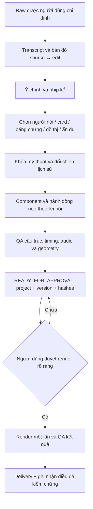

# Đề xuất V2 — Motion graphic paper và tương tác vật lý từ raw

Ngày: 28/10/2026. Trạng thái: **SKILLS_APPLIED** theo yêu cầu cập nhật của người dùng trong chat.
Bộ skill V2 đã được tích hợp và hoàn thiện thêm khi rà toàn repo. Runtime/pilot vẫn theo trạng thái thực tế;
chưa dựng hay render video trong lần cập nhật này. Xem [báo cáo áp dụng](application-report.md) và
[bộ skill đang dùng](../../motion-skill-system.md). Thư mục draft giữ snapshot đề xuất để đối chiếu lịch sử.

**Điều chỉnh V2 theo yêu cầu mới:** motion là phần chính của graphic beat; lấy thiết kế và motion của project
paper trước làm nền để đồng bộ. Chủ động thiết kế nhân vật có thể diễn khi nội dung phù hợp. Ưu tiên nghiên cứu
tiếp xúc, truyền lực, ma sát, biến dạng, khớp và phản lực. Các đoạn người nói hoặc đọc evidence vẫn có khoảng nghỉ.
Chi tiết: [vật lý](draft/.agents/skills/physical-interaction-direction/references/physical-dynamics.md),
[đồng bộ motion dự án trước](draft/.agents/skills/motion-graphic-design/references/paper-motion-continuity.md),
[thiết kế và diễn nhân vật](draft/.agents/skills/character-and-object-design/references/actor-performance.md).

## 1. Kết quả hướng tới

Bạn gửi một raw và yêu cầu dựng. AI tự tiếp nhận, giữ giọng nói và ý nghĩa, dựng timeline, chọn cách minh họa,
thiết kế, lập trình chuyển động, chuẩn bị asset, kiểm tra và gửi hồ sơ duyệt. Sau khi bạn duyệt rõ project/version,
AI mới render, kiểm tra kết quả và đóng gói. Không cần bạn chỉ đạo từng cảnh hoặc chọn từng card.

Mục tiêu 90–100% là giảm phần việc thủ công của bạn. Đây chưa phải năng lực đã đo hoặc bảo đảm cho mọi raw.
Chỉ cập nhật văn bản skill chưa tạo ra đầy đủ runtime; phần triển khai và thử nghiệm nằm ở mục 9.

## 2. Những lựa chọn đã chốt từ yêu cầu của bạn

- Thiết kế sáng tạo, rõ ý, đơn giản và dễ xem trên điện thoại; giữ màu sắc và ngôn ngữ hình ảnh nhất quán.
- Mỗi graphic beat có primary motion diễn đạt quan hệ/biến đổi theo lời; hold để đọc là một pha của motion, không thay toàn cảnh bằng slide tĩnh.
- Hướng tiếp nối này dùng nền giấy, ink, cam đất, Fraunces/Inter và grammar motion từ project paper trước; tạo mới tình huống và actor.
- Card, chữ, biểu đồ, ảnh thật, footage, hình khối, đồ vật hoặc con vật đều là lựa chọn hợp lệ.
- Chọn cách diễn đạt phù hợp nhất. Không đặt quota con vật, card, hiệu ứng hay số lần đổi shot.
- Card có nội dung và hành động cụ thể: so sánh, xếp hàng, bị chặn, phân loại, mở rộng, gộp, chuyển trạng thái.
- Chủ động đề xuất và thiết kế nhân vật khi có vai trò/hành động phù hợp và có thể dựng rõ bằng code; gắn với card/đạo cụ bằng contact có thật.
- Tái dùng cơ chế tốt, token và công cụ; tạo mới ý tưởng, silhouette và dàn cảnh khi nội dung cần.
- Giữ raw, giọng nói, nét diễn và các giới hạn quyền truy cập của AGENTS.md. Không tự viết lại lời nói thành quảng cáo.
- Ưu tiên quyết định độc lập, có fallback; chỉ hỏi khi thiếu thông tin thực sự chặn hoặc đến cổng duyệt đã đặt.

## 3. Khuyến nghị kiến trúc

Giữ Remotion + React + SVG làm nền. Đây là phương án ít thay đổi repo và phù hợp code hiện có.
HyperFrames là phương án thay thế cho project HTML riêng; chuyển engine ngay chưa giải quyết việc chọn ý tưởng.
Rive/Lottie là adapter tùy cảnh có asset phù hợp; Matter.js chỉ cân nhắc khi mô phỏng nhiều vật thật sự có ích.
Chưa đề xuất cài thêm dependency trong vòng duyệt này. Xem [nghiên cứu nguồn](research.md).

## 4. Hai skill mới và sáu skill cần sửa

Các bản nháp nằm trong `draft/.agents/skills/`, giữ đúng cấu trúc sẽ dùng khi áp dụng. Link trong bản nháp
được tính theo vị trí đích ở repo. `integration.patch` cho thấy thay đổi so với file đang làm việc, kể cả sửa dở.

| Skill | Thay đổi đề xuất | Nội dung chi tiết |
| --- | --- | --- |
| `physical-interaction-direction` mới | Biên đạo hành động và card có nguyên nhân–kết quả | [Skill](draft/.agents/skills/physical-interaction-direction/SKILL.md), [recipes](draft/.agents/skills/physical-interaction-direction/references/interaction-recipes.md), [triển khai](draft/.agents/skills/physical-interaction-direction/references/frame-driven-motion.md) |
| `character-and-object-design` mới | Dựng vật thể có bộ phận và khớp khi cảnh cần | [Skill](draft/.agents/skills/character-and-object-design/SKILL.md), [hướng dẫn rig](draft/.agents/skills/character-and-object-design/references/rig-and-material.md) |
| `creative-video-direction` | Chọn hình theo câu nói, mỹ thuật, chống slop, ghi nhớ thiết kế | [Chọn visual](draft/.agents/skills/creative-video-direction/references/editorial-selection.md), [lịch sử](draft/.agents/skills/creative-video-direction/references/design-memory.md) |
| `motion-graphic-design` | Motion là phần chính, kế thừa motion của project trước; card có hành động | Bản nháp SKILL.md, reference continuity và patch |
| `visual-paper-editorial` | Paper profile đồng bộ dự án trước; motion có contact và khoảng nghỉ, đúng cổng render | Bản nháp SKILL.md và patch |
| `ai-video-pipeline` | Route raw/TTS, kiểm tra năng lực thực tế, state, QA, approval | [Quy trình raw](draft/.agents/skills/ai-video-pipeline/references/raw-first-workflow.md), [QA](draft/.agents/skills/ai-video-pipeline/references/quality-and-acceptance.md) |
| `audio-speech-alignment` | Giữ voice raw, timestamp có độ tin cậy, edit time map | Bản nháp SKILL.md |
| `autonomous-skill-and-asset-evolution` | Học có bằng chứng, promotion cơ chế, quyền xử lý local raw | Bản nháp SKILL.md |

`docs/auto-production-system.md` cũng có bản nháp để kết nối quy trình và phân biệt mục tiêu với tool có thật.
Không tạo thêm nhiều skill nhỏ về màu, SFX hay retention: đặt chúng vào reference đúng nơi để tránh nạp trùng.

## 5. AI quyết định hình như thế nào

Mỗi beat cần một câu trả lời: “Người xem cần hiểu/nhìn thấy điều gì ở đây?”
Thử phương án đơn giản nhất trước; nếu ẩn dụ giúp hiểu nhanh hơn hoặc tạo payoff tốt hơn mới tăng độ phức tạp.
Một đoạn người nói thuyết phục có thể giữ nguyên. Một so sánh cần card có thể dùng card từ đầu đến cuối.

| Câu nói giả định | Cách chọn hợp lý | Hành động | Cách tránh làm quá |
| --- | --- | --- | --- |
| “Tôi thử cả hai cách, cách này đỡ phải kiểm lại” | Hai card cùng tiêu chí | Reveal cùng hàng; card còn lại giữ bối cảnh | Không tự bịa số tiết kiệm thời gian |
| “Thông báo chen ngang việc đang làm” | Task + notification | Thông báo đẩy task lệch, task lấy lại vị trí | Một gián đoạn rõ, không mưa icon |
| “Phải kiểm trước khi gửi” | Draft card + checkpoint | Card dừng tại gate, đổi trạng thái rồi đi tiếp | Gate chặn đúng card, không rung cả nền |
| “Việc lặt vặt ăn hết buổi sáng” | Cân nhắc đồng hồ bị che bởi task; sinh vật giấy chỉ khi hợp giọng vui | Bị chiếm diện tích hoặc nuốt tuần tự | Không diễn nhiều gag trong một câu |
| “Cái này tôi làm sai thật” | Giữ mặt và khoảng ngừng | Cut/reframe nhẹ nếu cần | Không mascot, badge hay shockwave che cảm xúc |

Đây là ví dụ suy luận thiết kế của bộ đề xuất, không phải cảnh bắt buộc hoặc template cho mọi video.
Xem [scene-examples.md](scene-examples.md) để đọc choreography cụ thể: card qua checkpoint, hai card so sánh,
task bị chồng, sinh vật giấy tùy tone, và một đoạn chỉ giữ người nói.

## 6. Nguyên tắc tương tác

- Chuỗi hành động: chuẩn bị → tiếp cận → tiếp xúc → hệ quả → ổn định. Chỉ giữ pha giúp đọc hành động.
- Điểm chạm là thật trong hệ tọa độ; thay đổi của bên bị tác động bắt đầu khi có tác động.
- Vật nặng, giấy, cao su và UI có phản ứng khác nhau. Chữ đọc được trên card không bị bóp méo liên tục.
- Một sự kiện chung điều khiển các bên, bóng, mask và SFX; không đặt delay độc lập rồi hy vọng chúng khớp.
- Mỗi beat có một hành động chính; nền, tiêu đề và camera không cùng tranh chú ý.
- Chuyển động có thời gian nghỉ. Mượt bao gồm tăng/giảm tốc và liên tục vị trí, không đồng nghĩa mọi thứ đều bounce.
- Chọn vật lý biên đạo, kết hợp hoặc mô phỏng theo nhu cầu; vẽ contact/readable action trước khi tuning spring.
- Phân biệt impulse lúc va, tải giữ khi đè, ma sát khi kéo, hinge khi mở/ăn và release trước hồi.
- Dùng các motion đã có làm nền; adapter bổ sung contact/overshoot thay vì copy cả scene. Nhân vật có intention, grip và follow-through.

Đã đọc script/timing/scenes và code của project `paper-2026-10-26-ai-agent-4-buoc`. Có source của mask reveal,
flip, slide, radial launch, stamp, conduit, cursor và click recoil. Một số wrapper clamp progress nên có thể cắt
overshoot; Scene15 đang trượt/thu/mờ card, chưa có rig nuốt bằng jaw/mask. Các nhận xét là rà source, chưa xác minh playback.

## 7. Định nghĩa “không AI slop” để có thể kiểm tra

| Dấu hiệu | Cách sửa cụ thể |
| --- | --- |
| Đọc lại nguyên câu voice bằng headline, caption và card | Giữ caption, rút graphic về một quan hệ hoặc bằng chứng |
| Mọi cảnh là card bo góc pop-in với số giả | Bỏ phần không có nguồn; chọn đúng cấu trúc của ý |
| Thêm robot/con vật vì đang nói về AI | Bỏ nhân vật nếu nó không làm điều gì giúp hiểu câu nói |
| Tất cả đều lắc, glow, float, swoosh | Chọn một điểm nhấn; dừng các phần còn lại |
| Đổi font, góc nhìn, chất liệu tùy cảnh | Dùng chung art-direction tokens; cho phép ngoại lệ có lý do |
| Ẩn dụ hiểu sai bản chất | Dùng card/đồ thị/ảnh bằng chứng trực tiếp hoặc giữ người nói |
| Hình mới chỉ khác màu hình cũ | So lại silhouette, quan hệ, bố cục, choreography; thiết kế lại phần bị lặp |
| Lời hứa giật gân không có payoff | Giữ trọng tâm thật từ raw, cho người xem thấy kết quả ở đúng đoạn |

Độ thu hút là giả thuyết cần kiểm chứng với người xem. QA nội bộ không được báo “tăng retention” hay “viral” như fact.

## 8. Tự động hóa cần được đo thế nào

- Đếm số thao tác/chỉ đạo bắt buộc của bạn, thời gian bạn cần tham gia, số beat bị sửa vì sai ý,
  số lỗi pixel/timing sau duyệt, tỷ lệ chạy lại, số lần hỏi lại dữ liệu đã có.
- Ghi rõ phần hoàn tất đến approval và phần sau render; không lấy phần trăm stage làm phần trăm lao động.
- Chưa có baseline thì báo “chưa đo”. Chỉ báo 90% khi so với baseline cùng loại video và cách tính công khai.
- Không có quyền render thì dừng đúng gate và đánh dấu pixel/motion playback QA pending; không coi pending là pass.
- Không thể bảo đảm mọi raw hoàn tất 100%: đoạn không nghe rõ, thiếu nguồn hoặc thiếu quyền cần được ghi rõ.
  AI vẫn hoàn thành mọi phần độc lập và dùng phương án đơn giản hợp lệ trước khi hỏi.

## 9. Lộ trình triển khai sau khi bạn duyệt đề xuất

| Giai đoạn | Công việc | Điều kiện hoàn tất |
| --- | --- | --- |
| A. Skill | Áp dụng patch có kiểm tra baseline; kích hoạt 2 skill và các reference | Frontmatter/link hợp lệ, không còn quy tắc mâu thuẫn |
| B. Intake/timeline | Chuẩn hóa raw registration, ASR, source-edit mapping, manifest, resume | Một raw được chỉ định tạo timeline có provenance; không sửa raw |
| C. Motion runtime | Thực thi dần các primitive ở [runtime plan](runtime-plan.md) | Seek ngẫu nhiên cho cùng pose; điểm chạm và text ổn định |
| D. QA/memory | Validator timeline, geometry, approval; registry có evidence | Lỗi contact/anchor/approval được phát hiện; dữ liệu lịch sử không bịa |
| E. Pilot | Một raw thực của bạn; làm đến hồ sơ duyệt | Scene rationale rõ, static/audio QA có bằng chứng, ít thao tác tay |
| F. Render được duyệt | Render đúng version một lần, review grid một lần, temporal QA, delivery | Pixel/audio/video QA đạt hoặc giới hạn được nêu trung thực |

Giai đoạn B–D là code cần triển khai và kiểm chứng, chưa có sẵn chỉ vì đã viết bản nháp skill.
Không xây tất cả primitive hay cài mọi thư viện trước pilot. Làm đủ cơ chế cảnh cần; chỉ promote cái đã hoạt động tốt.

## 10. Kiểm thử quyết định trước triển khai

Xem [acceptance-scenarios.md](acceptance-scenarios.md): card-only, không cần graphic, ẩn dụ sai nghĩa,
va chạm, timestamp chưa chắc, raw đổi, thiết kế trùng, tool thiếu, raw riêng tư, và chưa duyệt render.
Bản nháp cần chỉ ra đúng hành vi cho từng tình huống. Chất lượng animation thực phải kiểm tra trên pilot sau đó.

## 11. Phạm vi duyệt

Bạn duyệt **đề xuất raw-to-motion V2 ngày 28/10/2026** nghĩa là đồng ý áp dụng skill và triển khai local theo phạm vi này.
Đó chưa phải duyệt render video. Mỗi video vẫn cần project/version cụ thể theo AGENTS.md.
Manifest của đề xuất ghi hash baseline; khi áp dụng phải kiểm tra thay đổi mới, không chép đè file đã sửa sau ngày lập.

Đọc nhanh mục 2, 4, 7 và 9; phần kỹ thuật đầy đủ nằm trong các bản nháp và runtime plan.
Kết quả kiểm tra bộ hồ sơ: [validation.md](validation.md). Danh sách file đích và hash: `manifest.json`;
patch review: `integration.patch`. Các file này không tự kích hoạt hay áp dụng thay đổi.
